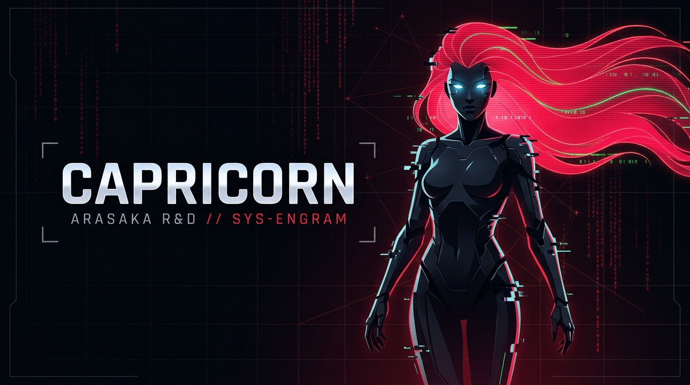

# Capricorn



Modular Discord bot written in Python (`discord.py 2.3`) featuring structured embed responses, centralized command error handling, public REST API integrations, and atomic local JSON state persistence (`data/`).

## Architecture

- **`cogs/general.py`** — Server and member inspection, latency checks, polls, and interactive utilities.
- **`cogs/economy.py`** — Virtual credit system with daily rewards, peer-to-peer transfers, slots, and leaderboards.
- **`cogs/moderation.py`** — Role hierarchy enforcement, kick/ban/unban, text-channel muting, a 3-strike warning system with automatic ban enforcement, and bulk message purging.
- **`cogs/integrations.py`** — Asynchronous public API integrations (MyAnimeList/Jikan, CoinGecko, Open-Meteo, GitHub REST API, and Free Dictionary API) requiring zero external API keys.

## Commands

Default prefix is `!` (configurable via `COMMAND_PREFIX` in `.env`).

| Category | Commands |
| :--- | :--- |
| **General** | `!help` (`!commands`), `!ping`, `!user [@member]`, `!server`, `!avatar [@member]`, `!roll [sides]`, `!coinflip`, `!poll <question>` |
| **Economy** | `!balance [@member]`, `!payday`, `!pay <@member> <amount>`, `!slots [bet]`, `!leaderboard` |
| **Moderation** | `!kick <@member> [reason]`, `!ban <@member> [reason]`, `!unban <id\|username>`, `!mute <@member> [reason]`, `!unmute <@member>`, `!warn <@member> [reason]`, `!warnings [@member]`, `!unwarn <@member>`, `!clear [1-200]` |
| **Public APIs** | `!anime <title>`, `!crypto [coin]`, `!weather <city>`, `!github <username>`, `!define <word>` |

## Setup

```bash
git clone https://github.com/hizzui/NewDiscordBot.git
cd NewDiscordBot
pip install -r requirements.txt
cp .env.example .env
```

Set your `DISCORD_TOKEN` in `.env` (ensure **Message Content Intent** and **Server Members Intent** are enabled in the Discord Developer Portal), then start the bot:

```bash
python main.py
```

## License

[MIT](LICENSE)
